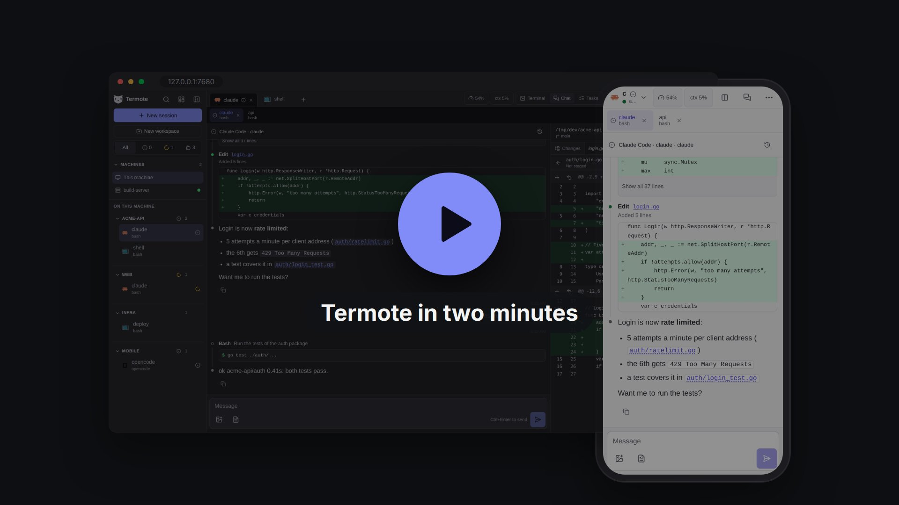
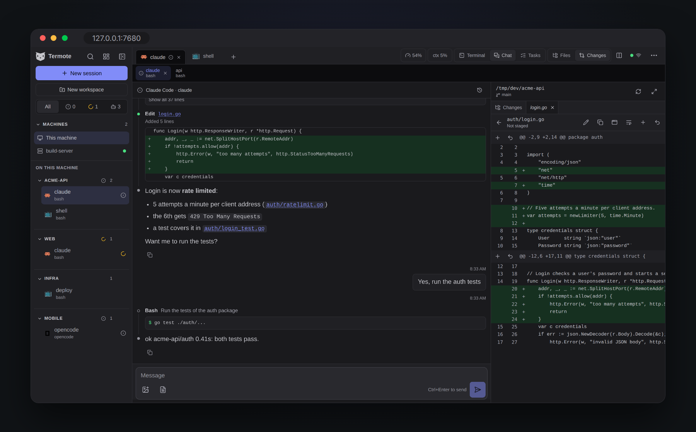
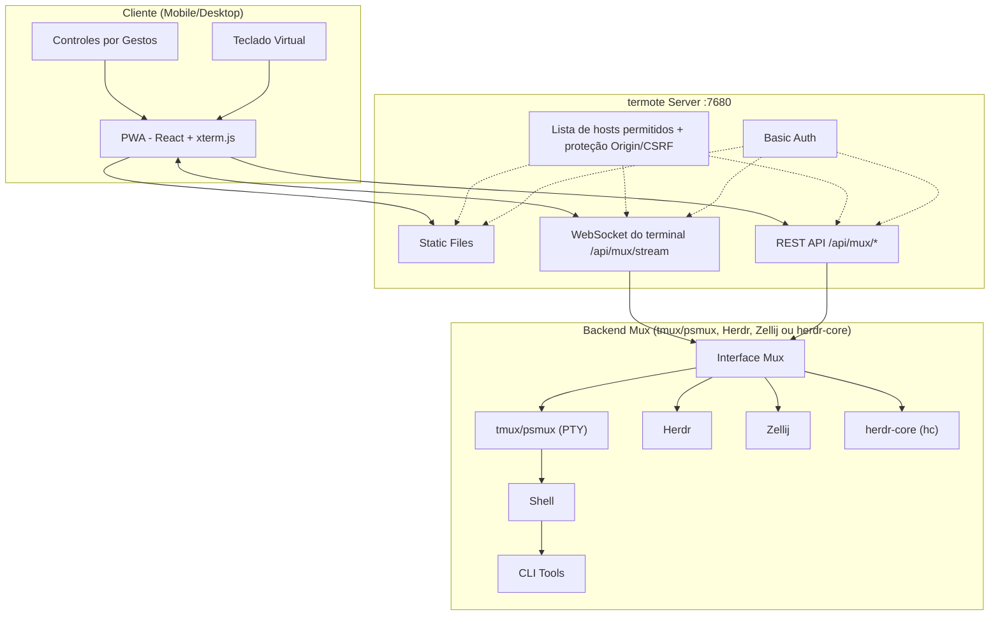
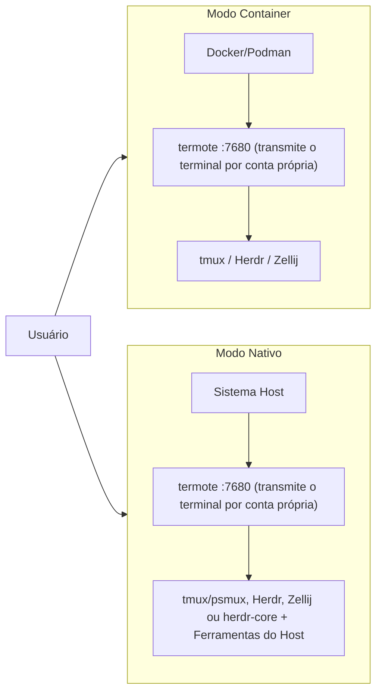

<p align="center">
  <picture>
    <source media="(prefers-color-scheme: dark)" srcset="assets/branding/termote/social/banner-readme-dark.svg" />
    
  </picture>
</p>

<p align="center">
  <a href="https://github.com/lamngockhuong/termote/releases"></a>
  <a href="https://github.com/lamngockhuong/termote/actions/workflows/ci.yml"></a>
  <a href="https://github.com/lamngockhuong/termote/blob/main/LICENSE"></a>
  <a href="https://github.com/lamngockhuong/termote/stargazers"></a>
  <a href="https://ghcr.io/lamngockhuong/termote"></a>
  <a href="https://hub.docker.com/r/lamngockhuong/termote"></a>
</p>

<p align="center">
  
  
  
  
</p>

<p align="center">
  <a href="https://launch.j2team.dev/products/termote?utm_source=badge-launched&utm_medium=badge&utm_campaign=badge-termote" target="_blank" rel="noopener noreferrer"></a>
  &nbsp;
  <a href="https://unikorn.vn/p/termote?ref=embed-termote" target="_blank"></a>
</p>

Controle remotamente ferramentas CLI (Claude Code, Codex, OpenCode, qualquer terminal) de dispositivos móveis/desktop via PWA.

> [!NOTE]
> O Termote 1.0 não atualiza uma instalação 0.x. Desinstale o 0.x conforme a
> [documentação arquivada do 0.x](https://termote.ohnice.app/0.x/) e depois instale o 1.0 com
> os comandos do [Início Rápido](#início-rápido).

> **Termote** = Terminal + Remote
>
> 🇬🇧 [English](README.md) | 🇻🇳 [Tiếng Việt](README.vi.md) | 🇨🇳 [简体中文](README.zh-CN.md) | 🇯🇵 [日本語](README.ja.md) | 🇰🇷 [한국어](README.ko.md) | 🇪🇸 [Español](README.es.md) | 🇫🇷 [Français](README.fr.md) | 🇩🇪 [Deutsch](README.de.md) | 🇷🇺 [Русский](README.ru.md) | 🇮🇩 [Bahasa Indonesia](README.id.md)

<p align="center">
  <a href="https://termote.ohnice.app/#see-it-in-a-minute"></a>
</p>

## Funcionalidades

- **Alternância de sessions**: Múltiplas tmux sessions com criar/editar/excluir
- **Abas de sessions**: Barra de abas horizontal para troca rápida entre janelas
- **Backend Herdr** (nativo ou no contêiner): controle workspaces do Herdr em vez do tmux, com selos de status do agente de código em cada painel — veja [Instalação nativa](https://termote.ohnice.app/installation/native/)
- **Visualização Chat**: leia e responda como um chat a um painel que executa Claude Code, Codex (iniciado com `--no-daemon`) ou OpenCode 2, com sugestões de comandos slash, respostas a diálogos e subagentes em execução — veja [Agent Chat](https://termote.ohnice.app/usage/agent-chat/)
- **Histórico de sessões**: liste as sessões do Claude Code, Codex e OpenCode que rodaram na pasta de um painel, leia uma delas, retome-a em uma nova aba ou faça um fork de uma que esteja em execução — veja [Resuming an Old Session](https://termote.ohnice.app/usage/agent-chat/#resuming-an-old-session)
- **Tokens e custo**: os tokens e o custo estimado de cada sessão de agente, com totais diários — veja [Tokens and cost](https://termote.ohnice.app/usage/overview/#tokens-and-cost)
- **Arquivos alterados por uma sessão**: os arquivos que uma sessão de agente editou, listados no Changes e no histórico de sessões, cada um abrindo seu diff — veja [Changes](https://termote.ohnice.app/usage/changes/#files-a-session-changed)
- **Visualizações Files e Changes**: navegue pelo diretório de um painel e suas alterações no git, com pré-visualização de Markdown, em todos os backends, inclusive o psmux no Windows — veja [Files and Changes](https://termote.ohnice.app/usage/files/)
- **Fila de mensagens e links de arquivos no Chat**: deixe uma mensagem na fila enquanto o agente trabalha; toque em um caminho de arquivo escrito pelo agente para abri-lo no Files, na sua linha
- **Revisão e staging**: comente linhas no Changes e no Files e envie a revisão a um agente; faça stage, unstage ou descarte uma alteração por arquivo ou por hunk
- **Pré-visualização e edição no Files**: PDF, .xlsx e .docx somente leitura; abra e salve arquivos Shift-JIS, EUC-JP e UTF-16; edite Markdown ao lado de uma pré-visualização ao vivo
- **Abrir no Windows** (WSL): copie o caminho Windows de um arquivo, ou abra um arquivo ou pasta com o programa do Windows, quando o servidor roda no WSL
- **Places**: ofereça no Files uma pasta fora do painel com `termote start --allow-path <dir>` — veja [Places](https://termote.ohnice.app/usage/files/#places)
- **Tasks**: execute os scripts do `package.json` e os targets do Makefile de um painel, envie uma execução com falha a um agente — veja [Tasks](https://termote.ohnice.app/usage/tasks/)
- **Worktrees**: abra um git worktree como um grupo próprio, a partir de um branch novo ou existente (Herdr, tmux, Zellij, herdr-core, psmux) — veja [Worktrees](https://termote.ohnice.app/usage/sessions/#worktrees)
- **Janelas próprias** (desktop): abra um arquivo, diff, aba, painel ou a visão geral em sua própria janela
- **Anexos de imagem**: envie uma imagem do celular para o terminal ou para uma mensagem da visualização Chat, para que o agente a leia pelo caminho; uma imagem colada no Claude Code, Codex ou OpenCode abre de novo pela visualização Chat
- **Backend Zellij** (Linux, macOS ou no container): controle suas sessões, abas e painéis do Zellij em vez do tmux (Zellij 0.45.0 ou posterior), escolhido com `--mux zellij` — veja [Instalação nativa](https://termote.ohnice.app/installation/native/)
- **Backend herdr-core** (nativo, qualquer SO): mostra os espaços, abas e painéis que o app herdr mostra, como mais um cliente do herdr-core (`hc` 0.1.16 ou posterior), escolhido com `--mux hc` — veja [Backend herdr-core](https://termote.ohnice.app/installation/native/#herdr-core-backend)
- **Machines**: acompanhe e controle os agentes dos seus outros computadores a partir de um único Termote, via SSH com uma chave que só alcança o Termote de lá (`termote machine add <alias>`) — veja [Machines](https://termote.ohnice.app/usage/machines/)
- **Plugin do Herdr**: abra no Termote o painel do Herdr em foco, mostre o link dele como QR code para o celular e inicie ou pare o servidor, sem sair do Herdr — veja [Herdr Plugin](https://termote.ohnice.app/usage/herdr-plugin/)
- **Otimizado para mobile**: Barra de teclado virtual (Tab/Ctrl/Shift/setas, expansível)
- **Suporte a gestos**: Deslizar para Ctrl+C, Tab, rolagem
- **Histórico de comandos**: Recuperar comandos enviados anteriormente com busca
- **Ações rápidas**: A tecla ⋯ fixada no fim da barra mobile mostra uma linha Actions com operações comuns (clear, cancel, exit)
- **Estilos de interface**: Neutral, Terminal ou Native, escolhidos nas Configurações, independentes do tema claro/escuro
- **Idioma da interface**: inglês ou vietnamita, escolhido nas Configurações; Auto segue o navegador
- **Configurações portáteis**: exporte as configurações deste navegador para um arquivo e importe-as em outro, ou revise as configurações que um agente de código propõe com `termote settings propose` — veja [Settings](https://termote.ohnice.app/usage/settings/#export-and-import)
- **Terminal na GPU**: o terminal é desenhado com WebGL2 quando o dispositivo tem GPU, o que mantém fluidas as saídas grandes
- **Indicador de conexão**: Status do servidor em tempo real com detecção automática de desconexão
- **Verificador de atualização**: Notificação automática de nova versão do GitHub releases
- **PWA**: Instalável na tela inicial, funciona offline
- **Sessions persistentes**: tmux mantém as sessions ativas
- **Barra lateral recolhível**: Interface desktop com barra lateral de sessions alternável
- **Modo tela cheia**: Experiência imersiva de terminal
- **Roda como serviço**: `termote start` registra um serviço do usuário (systemd, launchd, Tarefa Agendada) que inicia no login
- **Persistência de configuração**: `termote start` salva suas opções, com a senha armazenada criptografada

## Capturas de Tela

**[Experimente a demo](https://termote.ohnice.app/demo/)**: o app real no seu navegador, no celular ou no desktop, com dados fictícios e sem instalar nada.

<p align="center">
  
</p>

<p align="center">
  
</p>

<p align="center">
  
</p>

## Arquitetura



O termote transmite o próprio terminal (PTY no Unix, ConPTY no Windows) para o xterm.js na PWA; não existe mais um processo de terminal separado para fazer proxy. O modelo completo de proteção de requisições está em [`docs/system-architecture.md`](docs/system-architecture.md).

## Início Rápido

> 📖 **Novo no Termote?** Confira o [Guia de Início](docs/getting-started.md) para um passo a passo completo com exemplos.

**Linux / macOS:**

```bash
curl -fsSL https://termote.ohnice.app/install.sh | sh
termote start
```

**Homebrew (macOS, Linux):**

```bash
brew install lamngockhuong/tap/termote
termote start
```

Uma instalação pelo Homebrew é atualizada pelo brew, não por `termote update`: `brew upgrade termote && termote restart`. Para remover: `termote uninstall && brew uninstall termote`.

**Windows (PowerShell):**

```powershell
irm https://termote.ohnice.app/install.ps1 | iex
termote start
```

**Com um agente de programação:** cole o prompt de [Install with an agent](https://termote.ohnice.app/installation/agent/) no Claude Code, Codex ou outro agente. Ele segue [`agents.md`](https://termote.ohnice.app/agents.md), verifica se o servidor responde e deixa a senha com você.

O instalador precisa apenas de `curl`, `tar` e `sha256sum`/`shasum` (PowerShell no Windows), sem sudo nem permissão de administrador. Ele verifica o checksum do arquivo, instala o comando `termote` e não inicia nada. `termote start` salva as opções, cria uma senha na primeira vez (exibida uma única vez, e só em um terminal; `termote show-password` mostra de novo), registra o serviço e o inicia. Abra `http://127.0.0.1:7680` (Windows: `http://127.0.0.1:7690`).

Um backend de terminal precisa estar instalado antes: tmux (`sudo apt install tmux`, `brew install tmux`), psmux no Windows (`winget install psmux`) ou [Herdr](https://termote.ohnice.app/installation/native/). O primeiro `start` detecta qual usar. [Zellij](https://zellij.dev/documentation/installation) 0.45.0 ou posterior (Linux, macOS) nunca é detectado: escolha com `--mux zellij`. [herdr-core](https://herdr.dev/core/) (`hc` 0.1.16 ou posterior, qualquer SO, só nativo) também nunca é detectado: escolha com `--mux hc`.

### Opções comuns

```bash
termote start --lan                  # Listen on the LAN, not only this machine
termote start --tailscale myhost.ts.net  # Publish over Tailscale HTTPS
termote start --mux herdr            # Drive Herdr workspaces instead of tmux
termote start --mux zellij           # Drive Zellij sessions instead of tmux (Linux, macOS)
termote start --mux hc               # Show the herdr app's terminals through herdr-core
termote start --no-auth              # Disable basic auth (local use only)
```

As opções ficam salvas: uma flag não informada mantém o valor salvo, e uma opção booleana é desligada com `=false` (`termote start --lan=false`). As flags são as mesmas em todos os sistemas, inclusive no PowerShell.

### Comandos do dia a dia

```bash
termote status                       # What the running server reports
termote stop                         # Stop (it starts again at the next login)
termote restart                      # Restart with the saved options
termote logs follow                  # Tail the logs
termote show-password                # Print the saved username and password
termote url --qr                     # The link to open, as a QR code for a phone
termote pair                         # A one-time code that signs a new device in
termote devices                      # List the paired devices (devices revoke <id>)
termote machine add <ssh alias>      # Reach another computer's Termote (Machines in the sidebar)
termote update                       # Update to the latest release
termote uninstall                    # Remove the service, the command, the install and uploads
```

`update` troca para a nova versão, reinicia o serviço e volta para a anterior se a nova versão não subir. `uninstall` mantém a configuração (`~/.config/termote`) e os logs (`~/.local/state/termote`) e exibe os dois caminhos; `uninstall --purge` remove os dois também.

## Instalação

### Fixar uma versão

```bash
curl -fsSL https://termote.ohnice.app/install.sh | TERMOTE_VERSION=1.0.0 sh
termote update --version 1.0.0
```

```powershell
$env:TERMOTE_VERSION='1.0.0'; irm https://termote.ohnice.app/install.ps1 | iex
```

Sem `TERMOTE_VERSION`, o instalador usa a release estável mais recente (1.0 ou posterior) e não mexe em uma instalação existente. Com ela, essa versão é instalada ao lado da atual e passa a ser a versão ativa, o que também repara uma instalação quebrada. Uma pre-release (`X.Y.Z-rc.N`) só é instalada quando nomeada assim (ou com `termote update --version`), e só depois de publicada; veja o [Deployment Guide](docs/deployment-guide.md#pre-releases).

### Modo Container

```bash
termote container up                          # Run the published image (podman or docker)
termote container up --workspace ~/projects   # Mount a directory at /workspace
termote container status
termote container logs -f
termote container down
```

`container up` executa `ghcr.io/lamngockhuong/termote` na versão do `termote` instalado, com podman (preferido) ou docker, na porta 7680, com `~/termote-workspace` montado em `/workspace`. Ele aceita `--port`, `--lan`, `--tailscale`, `--cloudflare`, `--no-auth`, `--mux`, `--allow-host`, `--allow-path`, `--user`, `--fresh`, `--workspace` e `--build` (só em um checkout), salvos separadamente das opções de `start`; o usuário e a senha sao compartilhados com o servidor nativo. O Docker reinicia o container após um reboot; o Podman rootless não tem daemon para isso, então execute-o como uma unidade Quadlet.

> **Nota de segurança**: Evite montar `$HOME` diretamente — diretórios sensíveis como `.ssh`, `.gnupg` ficarão acessíveis no container. Monte apenas diretórios de projeto específicos.

### Docker sem a CLI

```bash
# Generates a password: docker exec termote cat /home/termote/.config/termote/password
docker run -d --name termote -p 7680:7680 \
  -v ~/projects:/workspace \
  ghcr.io/lamngockhuong/termote:latest

# With your own credentials
docker run -d --name termote -p 7680:7680 \
  -e TERMOTE_USER=admin -e TERMOTE_PASS=secret \
  ghcr.io/lamngockhuong/termote:latest
```

| Variável de Ambiente | Descrição                                                                                                        |
| -------------------- | ---------------------------------------------------------------------------------------------------------------- |
| `TERMOTE_USER`       | Usuário da autenticação básica (padrão: `admin`)                                                                 |
| `TERMOTE_PASS`       | Senha da autenticação básica (padrão: gerada automaticamente, salva em `/home/termote/.config/termote/password`) |
| `NO_AUTH`            | Defina como `true` para desativar a autenticação                                                                 |

### Compilar a partir do código fonte

```bash
git clone https://github.com/lamngockhuong/termote.git
cd termote
make build
./scripts/termote.sh start
```

`make build` compila o PWA e o embute em `server/termote`; requer Go, Node.js e pnpm. `scripts/termote.sh` (Windows: `scripts\termote.ps1`) só executa um checkout: recompila o binário de desenvolvimento quando algum fonte é mais novo e o executa com os mesmos argumentos. `termote update` se recusa a rodar em um checkout; use `git pull && make build`.

### Atualizando a partir do 0.x

Não há atualização a partir do 0.x: o 1.0 é instalado em outro local e não lê a configuração do 0.x. Desinstale o 0.x conforme a [documentação arquivada do 0.x](https://termote.ohnice.app/0.x/) e depois instale o 1.0 com os comandos acima.

## Modos de Implantação



| Modo      | Comando                | Caso de Uso                               | Plataforma            |
| --------- | ---------------------- | ----------------------------------------- | --------------------- |
| Nativo    | `termote start`        | Acesso a ferramentas do host (claude, gh) | macOS, Linux, Windows |
| Container | `termote container up` | Ambiente isolado                          | macOS, Linux, Windows |

O servidor nativo roda como serviço do usuário: uma unidade systemd de usuário no Linux (um processo desanexado quando não há systemd de usuário, como no WSL2 sem systemd), um agente launchd no macOS e uma Tarefa Agendada no logon no Windows.

### Opções de `start`

| Flag                              | Descrição                                                                                                         |
| --------------------------------- | ----------------------------------------------------------------------------------------------------------------- |
| `--port <port>`                   | Porta (padrão: 7680, Windows: 7690)                                                                               |
| `--lan[=false]`                   | Escutar em todas as interfaces (padrão: apenas localhost)                                                         |
| `--tailscale <host[:port]>`       | Publicar via Tailscale HTTPS (porta padrão 443)                                                                   |
| `--no-tailscale`                  | Parar de publicar via Tailscale                                                                                   |
| `--cloudflare <host>`             | Nome de host de um Cloudflare Tunnel que você executa; avisa quando o Cloudflare Access não está na frente dele   |
| `--no-cloudflare`                 | Esquecer o nome de host do Cloudflare                                                                             |
| `--proxy-client-header <name>`    | Cabeçalho em que um proxy coloca o endereço do cliente (padrão com `--cloudflare`: `CF-Connecting-IP`)            |
| `--no-proxy-client-header`        | Parar de lê-lo                                                                                                    |
| `--no-auth[=false]`               | Desativar a autenticação básica                                                                                   |
| `--mux <tmux\|herdr\|zellij\|hc>` | Backend do terminal (padrão: herdr quando estiver rodando, senão tmux; zellij: Linux, macOS; hc: herdr-core)      |
| `--allow-host <name>`             | Permitir um valor extra no cabeçalho Host (repetível; sem curinga, veja as notas de segurança)                    |
| `--remove-host <name>`            | Remover um nome de Host permitido (repetível)                                                                     |
| `--allow-local-user <name>`       | Permitir que outro usuário do sistema nesta máquina se conecte, ex.: um proxy reverso (repetível; Linux, Windows) |
| `--remove-local-user <name>`      | Deixar de permitir a conexão desse usuário (repetível)                                                            |
| `--allow-path <dir>`              | Oferecer uma pasta no Files, em Places (repetível)                                                                |
| `--remove-path <dir>`             | Remover uma pasta permitida (repetível)                                                                           |
| `--allow-herdr-no-auth`           | Obrigatório junto com `--mux herdr --no-auth`                                                                     |
| `--allow-hc-no-auth`              | Obrigatório junto com `--mux hc --no-auth`                                                                        |
| `--user <name>`                   | Nome de usuário de login (padrão: `admin`; compartilhado com o container)                                         |
| `--fresh`                         | Definir uma nova senha                                                                                            |

### Com Tailscale HTTPS

Usa `tailscale serve` para HTTPS automático (sem gerenciar certificados manualmente):

```bash
termote start --tailscale myhost.ts.net                # Default port 443
termote start --tailscale myhost.ts.net:8765           # Custom port
termote container up --tailscale myhost.ts.net         # Container mode
sudo tailscale set --operator=$USER                    # Linux, once: let termote run tailscale serve
```

O mapeamento é aplicado toda vez que o servidor inicia. `stop`, `start --no-tailscale` e `uninstall` removem apenas o mapeamento do próprio Termote.

## Suporte a Plataformas

| Plataforma | Container | Nativo | Instalador    |
| ---------- | --------- | ------ | ------------- |
| Linux      | ✓         | ✓      | `install.sh`  |
| macOS      | ✓         | ✓      | `install.sh`  |
| Windows    | ✓         | ✓      | `install.ps1` |

> **Suporte ao Windows**: O modo container requer Docker Desktop ou Podman Desktop; o modo nativo requer o [psmux](https://github.com/psmux/psmux) (multiplexador de terminal compatível com tmux para Windows), instalado com `winget install psmux`, ou um servidor [Herdr](https://herdr.dev/#install) em execução.

## Uso no Mobile

| Ação                 | Gesto                           |
| -------------------- | ------------------------------- |
| Cancelar/interromper | Deslizar para esquerda (Ctrl+C) |
| Tab completion       | Deslizar para direita           |
| Rolar para baixo     | Deslizar para cima              |
| Rolar para cima      | Deslizar para baixo             |
| Colar                | Pressionar longo                |
| Tamanho da fonte     | Pinçar para dentro/fora         |

A barra de ferramentas virtual oferece: Tab, Esc, Ctrl, Shift, teclas de seta e combinações de teclas comuns. Suporta combinações Ctrl+Shift (colar, copiar). Alterne entre modo mínimo e expandido para teclas adicionais (Home, End, Delete, etc.).

## Estrutura do Projeto

```
termote/
├── Makefile                # Build/test/run commands
├── Dockerfile              # Container image (termote + tmux + herdr + zellij)
├── docker-compose.yml      # Development from a checkout only
├── entrypoint.sh           # Container entrypoint
├── docs/                   # Documentation
│   └── images/screenshots/ # App screenshots
├── pwa/                    # React PWA
│   └── src/
│       ├── components/
│       ├── contexts/
│       ├── hooks/
│       ├── types/
│       └── utils/
├── server/                 # Go server + CLI (single binary)
│   ├── main.go             # Entry point (no args = menu, `serve` = server, else CLI)
│   ├── serve.go            # Server (PWA, auth, guards)
│   ├── mux.go              # Mux interface + /api/mux/* routes
│   ├── mux_tmux.go         # tmux/psmux backend
│   ├── mux_herdr.go        # Herdr backend
│   ├── mux_zellij*.go      # Zellij backend (commands, Chat view and Files)
│   ├── zellij_*.go         # Termote's Zellij clients, view-only stream, a pane's shell
│   ├── mux_hc*.go, hc_*.go # herdr-core backend (hc connect client, herdr-app document)
│   ├── stream.go           # Terminal WebSocket (xterm.js stream)
│   ├── agent_*.go          # Chat view, session history, tokens and cost (Claude Code, Codex, OpenCode)
│   ├── cli*.go             # start/stop/update/container/logs/menu subcommands
│   └── webui/              # PWA embedded in the binary (filled by make build)
├── scripts/
│   ├── install.sh          # Unix online installer (curl | sh)
│   ├── install.ps1         # Windows online installer (irm | iex)
│   ├── termote.sh          # Unix shim: builds and runs a checkout
│   └── termote.ps1         # Windows PowerShell shim: builds and runs a checkout
├── tests/                  # Test suite
│   ├── test-termote.sh     # Unix shim tests
│   ├── test-termote.ps1    # Windows shim tests
│   ├── test-install.sh     # Unix installer tests
│   ├── test-install.ps1    # Windows installer tests
│   └── test-entrypoints.sh # Container entrypoint tests
├── herdr-plugin/           # Herdr plugin (open a pane in Termote, QR code, start/stop)
├── video/                  # Remotion intro video
└── website/                # Astro Starlight docs site
    └── src/content/docs/   # MDX documentation
```

## Desenvolvimento

```bash
make build          # Build the PWA and embed it in server/termote
make test           # Run all tests
make health         # Check service health
make clean          # Stop containers

# E2E tests (requires running server)
./scripts/termote.sh start           # Start server first
pnpm --filter termote test:e2e       # Run Playwright tests
pnpm --filter termote test:e2e:ui    # Run with UI debugger
```

**Testes Manuais:** Veja o [Self-Test Checklist](docs/self-test-checklist.md)

## Solução de Problemas

### Session não persiste

- Verifique o tmux: `tmux ls`
- O termote se conecta com `tmux new-session -A` (attach-or-create)

### Erros de WebSocket

- Verifique os logs do termote: `termote container logs` (container) ou `termote logs server` (nativo)
- O WebSocket do terminal e `/api/mux/stream`, servido pelo próprio termote — não há processo de terminal separado para verificar

### Problemas com teclado no mobile

- Certifique-se de que a meta tag viewport está presente
- Teste em um dispositivo real, não em emulador

### Modo nativo: servidor não inicia

```bash
termote status             # What the running server reports
termote logs server        # Or: termote logs follow
lsof -i :7680              # Check what holds the port
termote start --fresh      # If the saved password can no longer be read
```

## Notas de Segurança

- **Padrão: apenas localhost** - não exposto à LAN a menos que a flag `--lan` seja usada
- **Autenticação básica ativada por padrão** - use `--no-auth` para desativar em desenvolvimento local; a senha é criada pelo primeiro `termote start` e salva criptografada
- **Allowlist de Host**: requisições com cabeçalho `Host` desconhecido são rejeitadas (proteção contra DNS rebinding); adicione nomes confiáveis com `--allow-host`, não há curinga para desligar a verificação
- **Proteções Origin/CSRF**: requisições `/api/mux/*` que alteram estado e o WebSocket `/api/mux/stream` rejeitam `Sec-Fetch-Site`/`Origin` de outros sites e exigem um token de stream de uso único, da mesma origem
- **Proteção integrada contra força bruta** - limitação de taxa (5 tentativas falhas/min por IP, 20/min por IPv6 /64)
- **Backend Herdr**: expõe todos os workspaces do Herdr no host, por isso `--mux herdr --no-auth` e recusado a menos que `--allow-herdr-no-auth` também seja informado
- **Backend Zellij**: expõe todas as sessões do Zellij em execução do usuário, como o tmux (sem proteção `--no-auth` extra); teclas e mensagens do Chat chegam a um painel apenas pelo terminal de um cliente Zellij do Termote, nunca por argumentos de processo que outros usuários locais poderiam ler
- **Backend herdr-core**: o herdr-core não tem login próprio, por isso `--mux hc --no-auth` e recusado a menos que `--allow-hc-no-auth` também seja informado, e `container up --mux hc` e recusado
- **Arquivos de serviço sem segredos**: a unidade systemd, o agente launchd e a Tarefa Agendada nunca contêm a senha
- Use HTTPS (Tailscale) em produção
- Restrinja a redes confiáveis/VPN
- O que um dispositivo conectado ou pareado pode fazer, e o que fazer quando um for perdido: [Modelo de segurança](docs/security-model.md)

## Outros Projetos

| Projeto                                                     | Descrição                                                                                                                                      |
| ----------------------------------------------------------- | ---------------------------------------------------------------------------------------------------------------------------------------------- |
| [GitHub Flex](https://github.com/lamngockhuong/github-flex) | Extensão multi-navegador (Chrome e Firefox) que aprimora a interface do GitHub com recursos de produtividade                                   |
| [TabRest](https://github.com/lamngockhuong/tabrest)         | Extensão do Chrome que descarrega automaticamente abas inativas para liberar memória                                                           |
| [Specpin](https://github.com/lamngockhuong/specpin)         | Fixa especificações de negócio vivas e versionadas com Git nos elementos da sua interface web em execução (extensão de navegador + sidecar Go) |

## Licença

MIT
